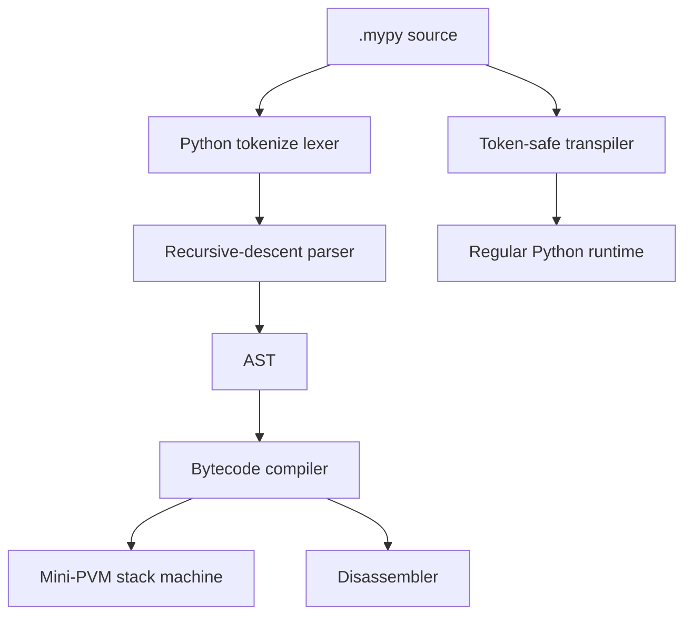

# Flavour: custom-keyword Python + Mini-PVM

Flavour provides a small Python-like language, a real stack bytecode VM, a disassembler,
a token-safe source transpiler, a REPL and a command-line tool. Runtime code uses only
the Python 3.8+ standard library.

## Architecture



## Install and quick start

```bash
python -m pip install -e .
flavour run examples/calculator.mypy
flavour dis examples/branching.mypy
flavour transpile examples/while_loop.mypy -o while_loop.py
flavour repl
```

Without arguments, `flavour` opens a numbered launcher menu. You can also use the
shorthand `flavour examples/calculator.mypy`.

## Dialect cheat sheet

| Python | Hinglish | Gen-Z |
|---|---|---|
| if | agar | lowkey |
| elif | warna agar / warna_agar | highkey |
| else | warna | deadass |
| while | jabtak | spin |
| for | har | vibe |
| in | mein | wit |
| print | likho | spill |
| True | sahi | fr |
| False | galat | cap |
| None | shunya | sus |
| def | banao | cook |
| return | bhejo | returnz |

The PVM subset currently supports assignments, arithmetic, comparisons, `if/elif/else`,
`while`, `for ... in range(...)`, print statements and the `str`, `int`, `float`,
`len`, and `abs` built-ins. The transpiler maps the broader Python keyword vocabulary.

## Opcode reference

| Opcode | Meaning |
|---|---|
| LOAD_CONST / LOAD_NAME | Push literal / variable |
| STORE_NAME | Pop into environment |
| BINARY_ADD / SUB / MUL / DIV / MOD | Arithmetic |
| COMPARE_OP | Comparison operator in argument |
| POP_JUMP_IF_FALSE / TRUE | Conditional branch |
| JUMP_ABSOLUTE | Unconditional branch |
| CALL_BUILTIN | Call supported builtin |
| PRINT_VALUE | Print and pop |
| HALT | Stop execution |

## Design notes

- The VM is stack-based; binary operations pop right operand then left operand.
- Compiler jump destinations are patched after branch bodies are emitted.
- `for` loops are compiled into hidden iterator and stop variables.
- The transpiler edits only `tokenize.NAME` spans, in reverse source order, preserving
  strings, comments, whitespace and identifiers containing keyword substrings.
- PVM is intentionally a learning-oriented subset, not a drop-in CPython replacement.
